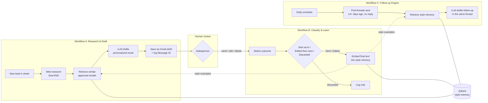

# AI Cold-Email Pipeline with Style Memory

A self-hosted n8n system that researches leads, drafts personalized outreach with an LLM, **learns the team's writing style from what humans actually send**, and runs follow-ups automatically.

I designed, built and operate this for a B2B software company's sales outreach. This repo is a case study. The production workflows, prompts and data stay private, so this README covers the design, the decisions and the problems I solved.

---

## The problem

Outreach was written by hand, one lead at a time:

- **Slow.** Each email meant researching the company, then writing from scratch.
- **Inconsistent.** The tone varied with whoever wrote it and how busy they were that day.
- **Leaky.** Follow-ups depended on someone remembering to send them, so many never went out.

Generic AI drafting tools would have made it faster, but every draft sounded like an AI and still needed heavy rewriting.

## What I built

Three n8n workflows that share a lead sheet and a vector "style memory":

### Workflow A: Research & Draft
- Picks up new leads from a shared Google Sheet.
- Researches each company through a self-hosted SearXNG search instance.
- Pulls the most similar **human-approved** past emails from the vector store and gives them to the LLM as style examples.
- Writes a personalized draft and saves it as a **Gmail draft**. Nothing is sent automatically; a person always approves first.
- Uses a `contact_mode` branch for leads with no personal name (e.g. `info@` addresses), so the email never opens with "Hi ,".

### Workflow B: Classify & Learn
- Checks what happened to each draft: **sent as-is**, **edited and then sent**, or **discarded**.
- Embeds the final text of sent emails into Qdrant (768-dim, cosine similarity).
- Over time the drafts move toward how the team actually writes, because every edit a salesperson makes becomes a training example.

### Workflow C: Follow-up Engine
- Runs daily and finds threads that were **actually sent** 14+ days ago with no reply.
- Drafts a short follow-up in the same thread, using the same style memory.
- It filters at the source to sent and edited-then-sent threads only, so follow-ups never go to drafts that nobody sent.

## Problems I solved along the way

| Problem | Fix |
|---|---|
| Sheet updates sometimes hit the wrong row when one contact appeared on several leads | Matched rows by **Gmail Message ID** instead of lead email, which gives each row a unique key |
| Leads with no personal name produced broken greetings | Added `contact_mode` branching with a separate prompt path for company-level contacts |
| Follow-ups were being generated for drafts that were never sent | Moved the sent / edited-then-sent filter to the start of the follow-up workflow instead of filtering at the end |
| Failures were silent; a broken node looked the same as "no new leads" | Added OpenTelemetry tracing and metrics to the surrounding services, with logs, traces and alerts in a Grafana / Loki / Tempo / Prometheus stack |
| Regressions when prompts or nodes changed | Wrote a zero-dependency Node.js test CLI that runs AI-generated test cases against staging and returns CI-friendly exit codes |

## What changed

- The team **reviews and edits drafts** instead of writing from a blank page.
- Drafts **sound like the team**, and they get closer the more the team uses the system.
- **Follow-ups go out on schedule** without anyone tracking them.
- Problems show up on a **dashboard** instead of being discovered weeks later.

## Stack

| Layer | Tools |
|---|---|
| Orchestration | n8n (self-hosted, Docker) |
| LLM | Self-hosted models served through Ollama |
| Style memory | Qdrant vector DB + open embedding model (768-dim, cosine) |
| Research | SearXNG (self-hosted meta-search) |
| Data & email | Google Sheets, Gmail API (drafts + thread tracking) |
| Ops | Docker Compose, Caddy, OpenTelemetry, Grafana / Loki / Tempo / Prometheus |
| Testing | Custom Node.js CLI (native `fetch`, no dependencies) |

## Design principles

1. **A person stays in the loop.** The system drafts; people send. That is what makes the learning signal trustworthy.
2. **Learn from behaviour, not from settings.** Nobody fills in a "brand voice" form; the system learns from what gets sent.
3. **Self-hosted by default.** Lead data and drafts never leave infrastructure we control.
4. **Observable.** Every workflow can be traced, so "it stopped working" becomes "this node failed at this time".

---

*Built and maintained by Kyle Christian Torrejos. I'm happy to walk through the system live.*
